<div align="center">


# PlanPilot

**Subscriptions on autopilot.**

A full-stack subscription management dashboard. Customers pick a plan, pay through Razorpay in test mode, track renewals and usage limits, and switch plans with fair proration. Admins get live analytics and full control over plans, subscriptions and accounts.

<p>
  
  
  
  
  
  
  
  
  
  
  
  <a href="https://github.com/Shanmugamrskfamily/subscription-dashboard-task/actions/workflows/ci.yml"></a>
</p>

<p>
  <!-- LIVE_URL --><a href="https://planpilot-dashboard.vercel.app"><b>Live demo</b></a>
  &nbsp;·&nbsp;
  <!-- LIVE_URL --><a href="https://planpilot-api-0i0d.onrender.com/api/docs"><b>API docs</b></a>
  &nbsp;·&nbsp;
  <a href="#see-it-in-action"><b>Demo GIF</b></a>
</p>

<sub>Built by <b>Shanmugam R</b> as the technical assessment for the Full Stack Web Developer role at Gnxtace Technologies.</sub>

</div>

---

**Contents:** [See it in action](#see-it-in-action) · [Try it in 30 seconds](#try-it-in-30-seconds) · [Screenshots](#screenshots) · [Requirement checklist](#requirement-checklist) · [Beyond the brief](#beyond-the-brief) · [Architecture](#architecture) · [Security](#security) · [API reference](#api-reference) · [Project structure](#project-structure) · [Getting started](#getting-started) · [Scripts](#scripts) · [Testing](#testing) · [Deployment](#deployment) · [Design](#design) · [Trade-offs and next steps](#trade-offs-and-next-steps) · [Author](#author)

## See it in action

<p align="center">
  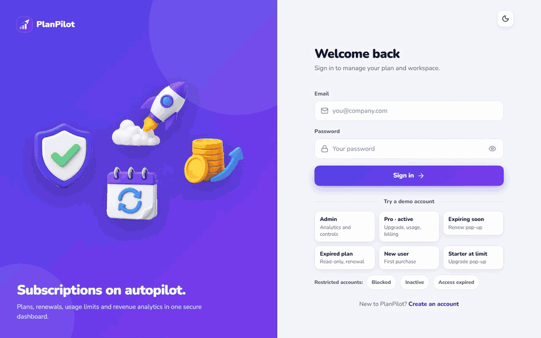
</p>

## Try it in 30 seconds

1. Open the <!-- LIVE_URL -->[live demo](https://planpilot-dashboard.vercel.app).
2. On the sign-in page, click any demo account card. One click fills in the form and signs you in.
3. When a plan needs paying for, Razorpay opens in **test mode**: use the UPI ID `success@razorpay` (or `failure@razorpay` to see the failure path), or a test card from [Razorpay's test card list](https://razorpay.com/docs/payments/payments/test-card-details/). No real money moves.

> [!NOTE]
> The API runs on Render's free tier, which sleeps after 15 idle minutes. The first request after a nap can take about 50 seconds; the app shows a "Waking up the server…" banner while it starts.

| Account        | Email                   | Password      | What it shows                                                                                                         |
| -------------- | ----------------------- | ------------- | --------------------------------------------------------------------------------------------------------------------- |
| Admin          | `admin@planpilot.demo`  | `Admin@12345` | Analytics overview, subscriptions table with filters and CSV export, user and plan controls, activity log             |
| Pro, active    | `priya@planpilot.demo`  | `Demo@12345`  | Upgraded mid-cycle from Starter, so billing history shows a prorated charge. Usage bars, upgrade and downgrade quotes |
| Expiring soon  | `kavya@planpilot.demo`  | `Demo@12345`  | Pro plan ending in 2 days: the renewal pop-up, an "expires soon" notification and early renewal                       |
| Expired        | `arjun@planpilot.demo`  | `Demo@12345`  | Starter expired 6 days ago: read-only workspace and a renew prompt                                                    |
| New user       | `neha@planpilot.demo`   | `Demo@12345`  | No plan yet (status "none"): the first purchase                                                                       |
| At the limit   | `dev@planpilot.demo`    | `Demo@12345`  | Starter with 3 of 3 projects: creating a fourth opens the upgrade dialog                                              |
| Blocked        | `rohan@planpilot.demo`  | `Demo@12345`  | Sign-in refused: "Your access has been blocked by an administrator." with the reason                                  |
| Inactive       | `sneha@planpilot.demo`  | `Demo@12345`  | Sign-in refused: "Your account is inactive." with the reason                                                          |
| Access expired | `vikram@planpilot.demo` | `Demo@12345`  | Sign-in refused: "Your access expired on …" (the admin's access-until date has passed)                                |

These are test credentials for a demo database. Around 50 more sample customers with six months of plan history, payments and usage fill the charts and tables. It is all sample data, and "Online now" only ever counts real activity. The demo rebuilds itself every night (02:00–05:00 IST) once it is a day old, so each account above is always in the state its row describes.

**A two-minute tour:** sign in as Neha and buy Starter → as Kavya, renew from the expiry pop-up (30 days are added after the current end date) → as Priya, open Plans and preview the Business upgrade (the credit for unused days is shown before you pay) → as Dev, try to add a project → as the admin, click a slice of the plan-mix chart to open the filtered subscriptions table, then open a customer and change their status → sign in as Rohan to see the blocked message.

## Screenshots

**Customer**

<table>
  <tr>
    <td width="50%">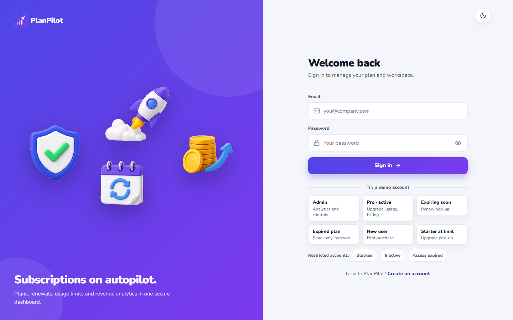<br /><sub>Sign-in with one-click demo accounts</sub></td>
    <td width="50%">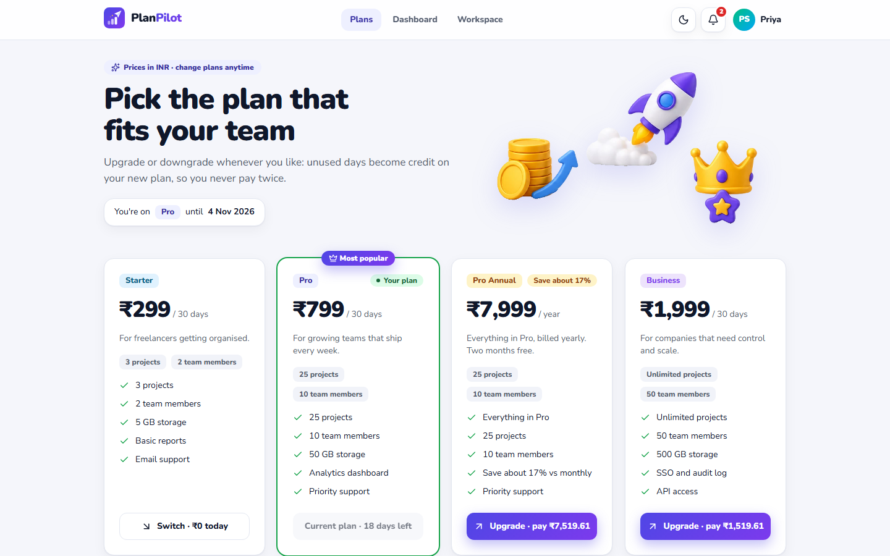<br /><sub>Plans, each button showing the real cost of switching</sub></td>
  </tr>
  <tr>
    <td width="50%">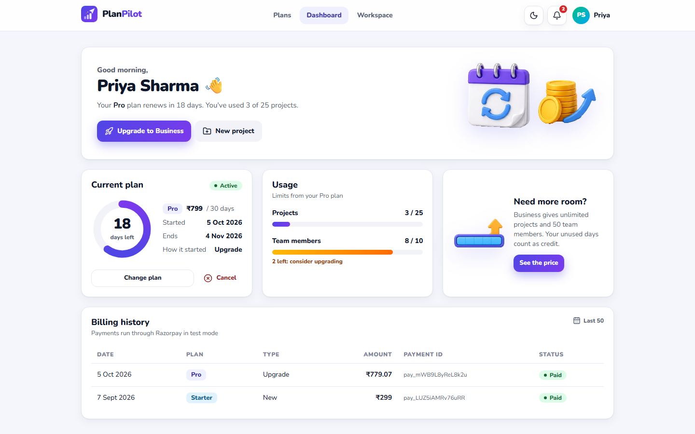<br /><sub>Dashboard: status, days left, usage and billing (light)</sub></td>
    <td width="50%">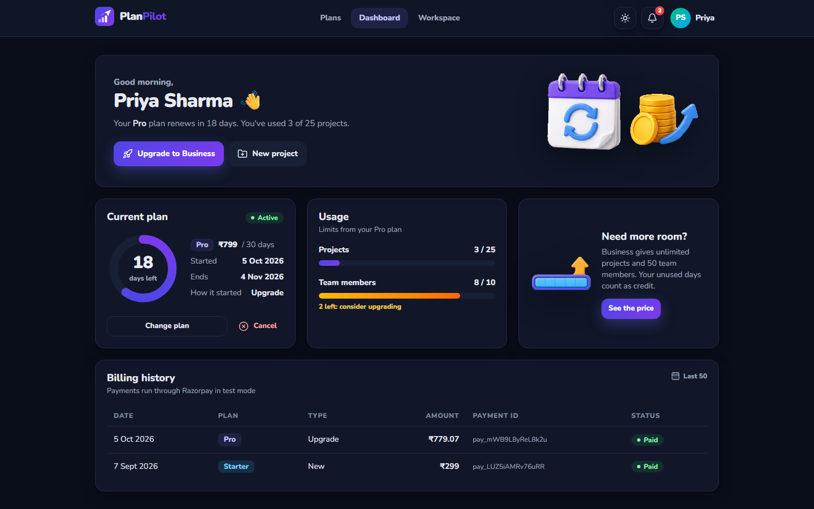<br /><sub>The same dashboard in dark mode</sub></td>
  </tr>
  <tr>
    <td width="50%">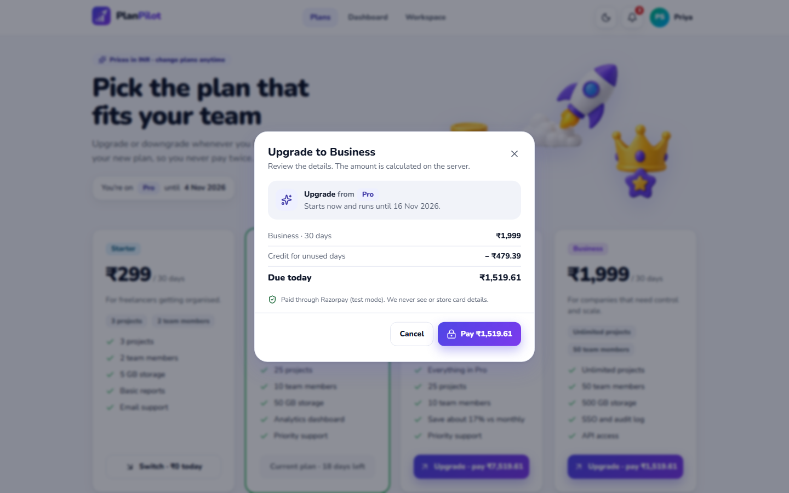<br /><sub>Upgrade preview: credit, amount due and new end date</sub></td>
    <td width="50%">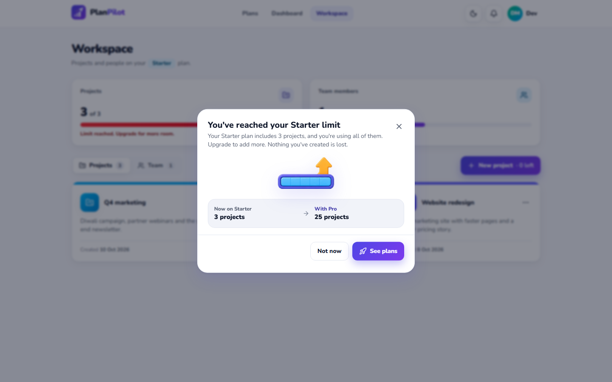<br /><sub>Plan limit reached: the upgrade dialog</sub></td>
  </tr>
</table>

**Admin**

<table>
  <tr>
    <td width="50%">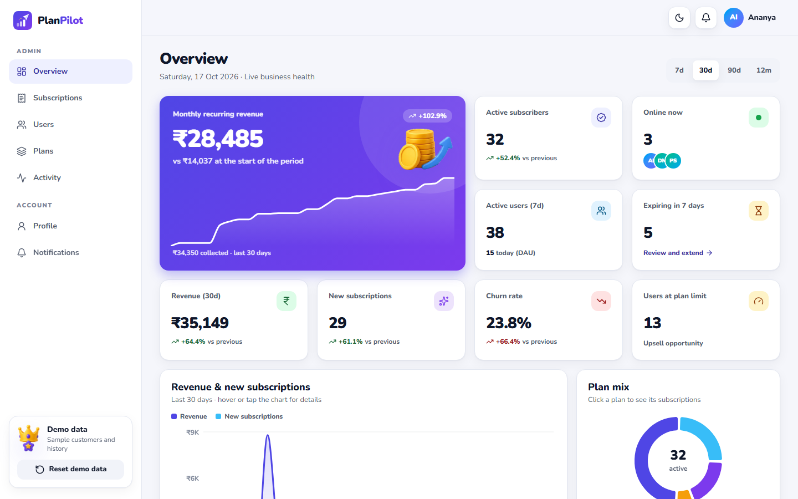<br /><sub>Analytics overview (light)</sub></td>
    <td width="50%">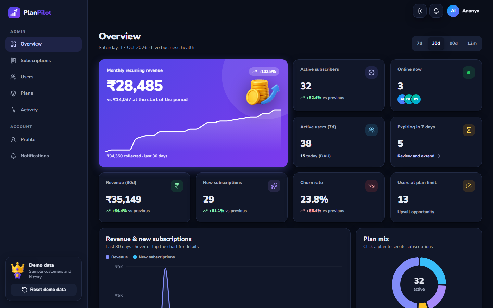<br /><sub>Analytics overview (dark)</sub></td>
  </tr>
  <tr>
    <td width="50%">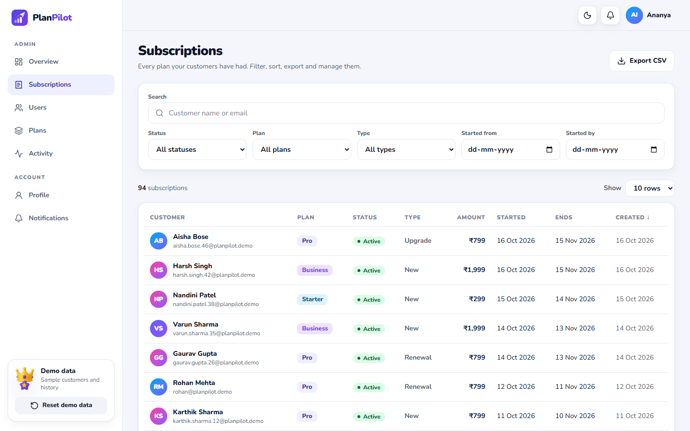<br /><sub>Subscriptions: search, filters, sorting, CSV export</sub></td>
    <td width="50%">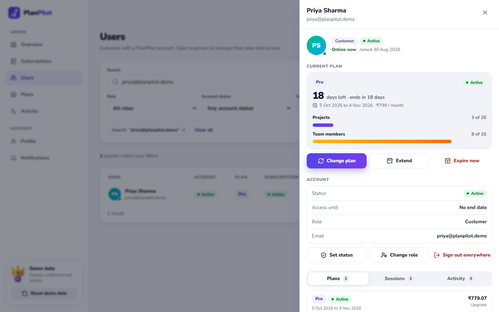<br /><sub>User drawer: plan, status, access date, sessions</sub></td>
  </tr>
</table>

**Account controls and phones**

<table>
  <tr>
    <td width="50%">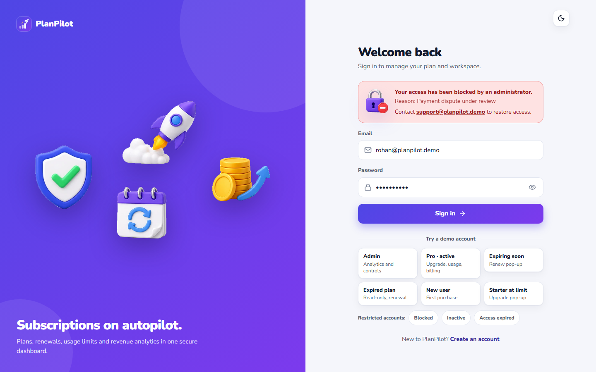<br /><sub>A blocked account sees why, after the correct password</sub></td>
    <td width="25%">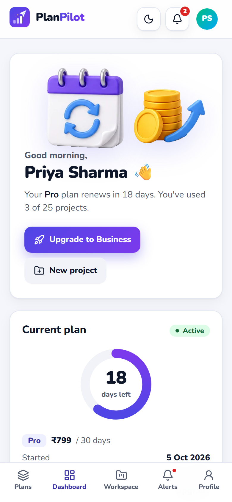<br /><sub>Phone: dashboard</sub></td>
    <td width="25%">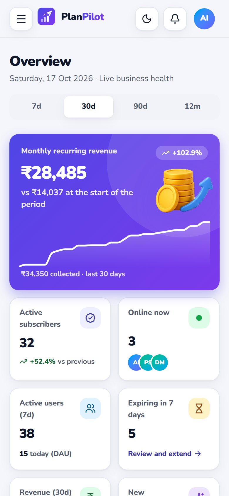<br /><sub>Phone: admin</sub></td>
  </tr>
</table>

## Requirement checklist

Every item in the brief, and where to find it.

| Requirement                                                       | How PlanPilot meets it                                                                                                       | Code                                                                                                                       |
| ----------------------------------------------------------------- | ---------------------------------------------------------------------------------------------------------------------------- | -------------------------------------------------------------------------------------------------------------------------- |
| **Stack:** React (Vite), Tailwind CSS, Redux Toolkit              | React 19 on Vite 8, Tailwind CSS 4, Redux Toolkit 2 with RTK Query                                                           | [client/package.json](client/package.json)                                                                                 |
| **Stack:** Node.js + Express                                      | Node 24, Express 5, TypeScript end to end                                                                                    | [server/src/app.ts](server/src/app.ts)                                                                                     |
| **Stack:** PostgreSQL or MongoDB with an ORM                      | MongoDB Atlas with Mongoose 9                                                                                                | [server/src/modules](server/src/modules)                                                                                   |
| JWT access and refresh tokens                                     | 15-minute access JWT plus a 7-day refresh token that rotates on every use, with reuse detection                              | [auth.service.ts](server/src/modules/auth/auth.service.ts), [tokens.ts](server/src/utils/tokens.ts)                        |
| RBAC middleware (admin, user)                                     | `authenticate` re-reads the user and session on every request; `authorize('admin')` and `authorize('user')` guard the routes | [authenticate.ts](server/src/middlewares/authenticate.ts)                                                                  |
| `plans`: id, name, price, features, duration                      | Plus slug, tier, usage limits, popular flag and archive state; price stored in paise                                         | [plan.model.ts](server/src/modules/plans/plan.model.ts)                                                                    |
| `users`: id, name, email, password, role                          | bcrypt hash; plus account status, access-until date, usage counters and lockout fields                                       | [user.model.ts](server/src/modules/users/user.model.ts)                                                                    |
| `subscriptions`: id, user_id, plan_id, start and end date, status | Plus amount paid, change type, payment and admin adjustments; a partial unique index allows one active plan per user         | [subscription.model.ts](server/src/modules/subscriptions/subscription.model.ts)                                            |
| Seed 3–4 realistic plans                                          | Starter ₹299, Pro ₹799, Business ₹1,999 (30 days each) and Pro Annual ₹7,999 (365 days), plus a sample database              | [plans.data.ts](server/src/seed/plans.data.ts), [seed.ts](server/src/seed/seed.ts)                                         |
| Validation with Joi, Yup or Zod                                   | Yup schemas in `shared/`, used by the Formik forms and by the API; unknown keys stripped, every failing rule reported        | [shared/src/schemas](shared/src/schemas), [validate.ts](server/src/middlewares/validate.ts)                                |
| Structured errors and status codes                                | One shape everywhere: `{ success: false, error: { code, message, details, requestId } }`                                     | [error-handler.ts](server/src/middlewares/error-handler.ts), [errors.ts](shared/src/errors.ts)                             |
| `POST /api/auth/register`, `POST /api/auth/login`                 | As named; both set the refresh cookie and return the access token                                                            | [auth.routes.ts](server/src/modules/auth/auth.routes.ts)                                                                   |
| `GET /api/plans`                                                  | Public; active plans ordered by tier                                                                                         | [plan.routes.ts](server/src/modules/plans/plan.routes.ts)                                                                  |
| `POST /api/subscribe/:planId`                                     | New, upgrade, downgrade or renewal; activates at once when credit covers it, otherwise returns a Razorpay order              | [subscription.routes.ts](server/src/modules/subscriptions/subscription.routes.ts)                                          |
| `GET /api/my-subscription`                                        | Active plan with usage and limits, or `none`, `expired` or `cancelled` with the last plan                                    | [subscription.service.ts](server/src/modules/subscriptions/subscription.service.ts)                                        |
| `GET /api/admin/subscriptions` (admin only)                       | Paginated, searchable, filterable by status, plan, change type and dates, sortable, CSV export                               | [admin.routes.ts](server/src/modules/admin/admin.routes.ts)                                                                |
| Page `/login`, `/register`                                        | Formik + Yup, password strength meter, one-click demo accounts, return to the page you asked for                             | [LoginPage.tsx](client/src/features/auth/LoginPage.tsx), [RegisterPage.tsx](client/src/features/auth/RegisterPage.tsx)     |
| Page `/plans`                                                     | Plan cards that show the real cost of switching, a preview before paying, FAQ                                                | [PlansPage.tsx](client/src/features/plans/PlansPage.tsx), [CheckoutFlow.tsx](client/src/features/billing/CheckoutFlow.tsx) |
| Page `/dashboard`                                                 | Status, animated days-left ring, dates, usage bars, features, billing history; change, renew or cancel                       | [DashboardPage.tsx](client/src/features/subscription/DashboardPage.tsx)                                                    |
| Page `/admin/subscriptions`                                       | Filters kept in the URL, sortable columns, detail drawer with admin actions, CSV export                                      | [SubscriptionsPage.tsx](client/src/features/admin/SubscriptionsPage.tsx)                                                   |
| Global state for auth and user                                    | Redux `auth` slice plus the RTK Query cache                                                                                  | [authSlice.ts](client/src/features/auth/authSlice.ts), [store.ts](client/src/app/store.ts)                                 |
| Store tokens securely                                             | Access token in memory only; refresh token in an HttpOnly, Secure, SameSite=Strict `__Host-` cookie that scripts can't read  | [auth.controller.ts](server/src/modules/auth/auth.controller.ts)                                                           |
| Auto logout or silent refresh                                     | Both: refresh 60 s before expiry and on a 401, sign-out after 30 idle minutes, sign-out followed in every tab                | [SessionManager.tsx](client/src/features/auth/SessionManager.tsx), [baseQuery.ts](client/src/api/baseQuery.ts)             |
| Role-protected routes                                             | `RequireAuth` and `RequireRole` guards; a customer opening `/admin` gets a 403 page                                          | [guards.tsx](client/src/app/guards.tsx), [router.tsx](client/src/app/router.tsx)                                           |
| Responsive, professional UI                                       | Mobile-first; bottom tab bar on phones, tables become cards below 640 px                                                     | [AppShell.tsx](client/src/components/layout/AppShell.tsx), [data.tsx](client/src/components/ui/data.tsx)                   |
| Navbar with logout and user menu                                  | Logo, links, theme toggle, notification bell, account menu with profile and sign-out                                         | [controls.tsx](client/src/components/layout/controls.tsx)                                                                  |
| Status: active, expired or none                                   | Status badges throughout, plus pop-ups when a plan is about to expire or has ended                                           | [badge.tsx](client/src/components/ui/badge.tsx), [PlanReminders.tsx](client/src/features/subscription/PlanReminders.tsx)   |
| **Bonus:** Stripe or Razorpay (test mode)                         | Razorpay Orders API and Checkout; the signature is verified on the server                                                    | [gateway.ts](server/src/modules/payments/gateway.ts), [payment.service.ts](server/src/modules/payments/payment.service.ts) |
| **Bonus:** dark/light theme toggle                                | Light, Dark or System; applied before first paint and synced across tabs                                                     | [theme.tsx](client/src/features/theme/theme.tsx), [theme-init.js](client/public/theme-init.js)                             |
| **Bonus:** upgrade/downgrade logic                                | Proration: credit for unused days, bonus days when credit exceeds the new price; early renewal adds a period after the end   | [proration.ts](server/src/modules/subscriptions/proration.ts)                                                              |
| **Bonus:** deployment                                             | Vercel (web), Render (API), MongoDB Atlas; CI on GitHub Actions                                                              | [vercel.json](vercel.json), [render.yaml](render.yaml), [ci.yml](.github/workflows/ci.yml)                                 |

## Beyond the brief

- **Encrypted API payloads.** Every request and response body is sealed with AES-256-GCM under a per-tab key agreed with ECDH P-256 and HKDF. Only the server's public key ships in the bundle. Each body is bound to its method, path, timestamp and a one-time nonce, so it can't be altered, moved to another call or replayed. [How it works](docs/ARCHITECTURE.md#encrypted-api-envelope)
- **Usage limits per plan.** Starter allows 3 projects and 2 team members, Pro 25 and 10, Business unlimited and 50. The server reserves each slot with one atomic conditional update, so two requests racing for the last slot can't both win. Usage bars on the dashboard, an upgrade dialog at the limit, and a read-only workspace without a plan.
- **Admin account controls.** From a user drawer, an admin can assign or change a plan without payment, extend or expire it, set the account to active, inactive or blocked, set an "access until" date, change the role, or sign the user out of every device. Plan and status changes need a reason (5–200 characters), are logged and notify the user. Admins can't act on themselves, and the last active admin can't be removed.
- **Specific sign-in errors.** Blocked, inactive and access-expired accounts each get their own message with the admin's reason, shown only after the correct password, so nobody can probe which emails exist. A restriction applied to a signed-in user ends their session on the next request, with a modal that explains why.
- **Proration with credit and bonus days.** Unused days become credit on the new plan; credit beyond the new price turns into bonus days. A preview shows the exact breakdown before anything is charged. [Worked example](#subscription-lifecycle-and-proration)
- **Early renewal.** Customers can renew the plan they are on from the dashboard, the plans page or the expiry pop-up: they pay the plan price and a full period is added after the current end date, so no paid day is lost. One renewal ahead is allowed.
- **Notifications.** Toasts for every action, a bell with an unread count (polled every 30 s), a notifications page grouped by day with an unread filter, and pop-ups when a plan expires within 3 days or has ended. A background job sends reminders 3 days and 1 day before the end date.
- **Admin analytics.** MRR, revenue, active subscribers, new subscriptions and sign-ups, churn, users online now (refreshed every 20 s), active users, plans expiring soon and users at their limit, over 7 days, 30 days, 90 days or 12 months. Clicking a plan or status slice opens the subscriptions table already filtered.
- **Audit and activity log.** Sign-ups, sign-ins, plan changes, admin actions and security events (account lockouts, refresh-token reuse, payment signature mismatches) in an admin feed. Entries expire after 30 days.
- **CSV export.** Downloads the filtered subscriptions; cells starting with `=`, `+`, `-` or `@` are neutralised against spreadsheet formula injection.
- **Session management.** The profile page lists every signed-in device; sign out one, or every device at once. Changing the password signs out all other devices.
- **Idle sign-out and cross-tab sync.** After 30 idle minutes a 60-second warning appears, then the session ends. Signing in or out in one tab is followed in every tab, a Web Lock stops two tabs refreshing at the same moment, and the theme choice syncs too.
- **Loading and error states.** Branded splash and loader, skeleton placeholders, a route progress bar, an offline banner, a "waking up the server" banner for cold starts, empty states with a next step, and branded 404, 403 and 500 pages.
- **Accessibility.** WCAG AA colour contrast in both themes, skip-to-content links, visible labels with field-level errors, keyboard-friendly menus and dialogs built on Radix primitives, 44 px touch targets on phones, reduced-motion support, and axe scans in light and dark in the E2E suite.
- **SEO and link previews.** Static Open Graph and Twitter tags with a 1200 × 630 share image, JSON-LD for the app and its four INR plans, per-page titles, `robots.txt` and `sitemap.xml` written at build time, and a web manifest with icons. The logo, icons and share image are rendered from one HTML source by [generate-brand-assets.mjs](scripts/generate-brand-assets.mjs).
- **Developer credit.** Every page ends with a footer (pricing, API documentation and source code links) and a "Designed & developed by" card with the developer's portfolio, GitHub, LinkedIn and email; the sign-in pages show the same card. It stacks into a single column on phones.
- **CSP and security headers** on both the web app and the API. [Details](#security)
- **Tests and CI.** 230 unit and integration tests with coverage gates, 59 Playwright end-to-end tests with axe, Git hooks and a GitHub Actions pipeline. [Details](#testing)

## Architecture

| Layer    | Choice                                                                                                                                                       |
| -------- | ------------------------------------------------------------------------------------------------------------------------------------------------------------ |
| Web app  | React 19, Vite 8, TypeScript, Tailwind CSS 4, Redux Toolkit + RTK Query, React Router 7, Formik + Yup, Radix UI primitives, Recharts, Motion, Sonner, Lucide |
| API      | Node.js 24, Express 5, Mongoose 9, jsonwebtoken, bcryptjs, helmet, express-rate-limit, pino, Swagger UI                                                      |
| Shared   | Yup schemas, error codes, types and the Web Crypto envelope, used by both sides (npm workspaces)                                                             |
| Data     | MongoDB Atlas; an in-memory replica set for local development and tests                                                                                      |
| Payments | Razorpay Orders API and Checkout, test mode                                                                                                                  |
| Hosting  | Vercel (web), Render (API, Singapore), MongoDB Atlas                                                                                                         |

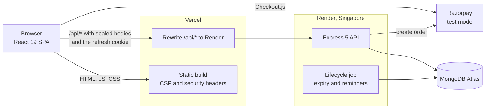

The browser only ever talks to the Vercel origin. Vercel rewrites `/api/*` to Render (Vite's dev proxy does the same locally), so the refresh cookie is first-party, the strict `SameSite` and `__Host-` rules work, and the CSP can keep `connect-src 'self'`.

**Encrypted request and response**

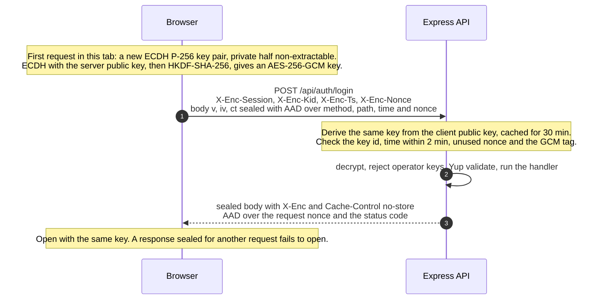

**Sign-in and silent refresh, with rotation and reuse detection**

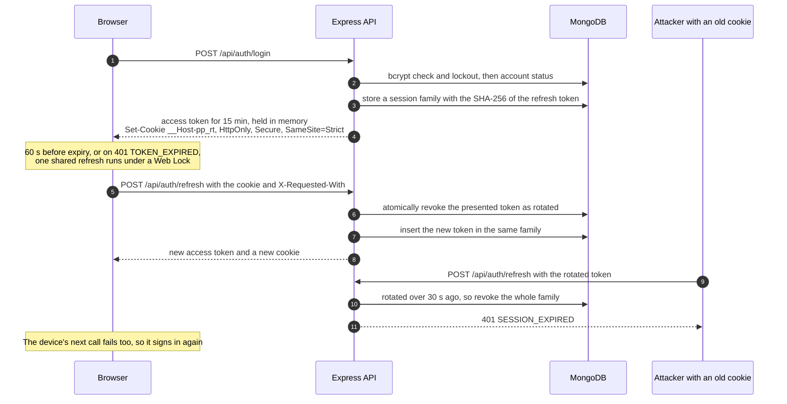

### Subscription lifecycle and proration

A user has at most one active subscription, enforced by a partial unique index in MongoDB, so two simultaneous purchases can't both succeed. `GET /api/my-subscription` reports `active`, `expired`, `cancelled` or `none`. A background job runs on boot and every 5 minutes: it expires plans past their end date and sends reminders 3 days and 1 day before, each exactly once. Reads check expiry as well, so a plan never looks active past its end date even if the free Render instance slept through a run. Without an active plan the workspace is read-only: items can be viewed and deleted, not created or edited.

Paid changes go through Razorpay: the server calculates the amount and creates the order, Checkout collects the payment, and `POST /api/payments/verify` checks the signature, then closes the old period and opens the new one inside a MongoDB transaction. When credit covers the new plan, the switch happens at once with nothing to pay.

Every plan change uses one rule from [`proration.ts`](server/src/modules/subscriptions/proration.ts): **credit** is the unused share of what the current period was worth (by time left, rounded down to whole paise); **amount due** is the new price minus credit, never below zero, and under ₹1 counts as zero; credit left over becomes **bonus days** on the new plan at its daily rate, up to 365. The new plan always starts now. The one exception is **renewing the current plan early**: the full price is charged and the new period starts where the current one ends (for example, Pro with 2 days left, renewed today, runs for 2 + 30 = 32 days); one renewal ahead is allowed. Two worked examples of plan changes:

|              | Upgrade: Starter to Pro                      | Downgrade: Pro to Starter                                            |
| ------------ | -------------------------------------------- | -------------------------------------------------------------------- |
| Current plan | Starter, ₹299 for 30 days, 12 days left      | Pro, ₹799 for 30 days, 20 days left                                  |
| Credit       | ⌊29,900 × 12 ÷ 30⌋ = 11,960 paise = ₹119.60  | ⌊79,900 × 20 ÷ 30⌋ = 53,266 paise = ₹532.66                          |
| Amount due   | 79,900 − 11,960 = 67,940 paise = **₹679.40** | max(0, 29,900 − 53,266) = **₹0**                                     |
| Bonus days   | None                                         | Leftover 23,366 paise ÷ (29,900 ÷ 30 per day) = 23.4, so **23 days** |
| New period   | Pro for 30 days from today                   | Starter for 30 + 23 = **53 days** from today                         |

A higher tier is an upgrade and a lower tier a downgrade; on the same tier, a longer billing period (Pro to Pro Annual) counts as an upgrade. More detail, including the data model and the payment sequence, is in [docs/ARCHITECTURE.md](docs/ARCHITECTURE.md).

## Security

Each measure below is in the code, and most are exercised by [`security.test.ts`](server/tests/security.test.ts), [`auth.test.ts`](server/tests/auth.test.ts), [`encryption.test.ts`](server/tests/encryption.test.ts) and [`subscriptions.test.ts`](server/tests/subscriptions.test.ts).

- **Security headers on the API** ([security.ts](server/src/middlewares/security.ts)): helmet with its own CSP (`default-src 'none'; frame-ancestors 'none'; base-uri 'none'; form-action 'none'`), HSTS for one year, `Referrer-Policy: no-referrer`, a same-site resource policy, and no `X-Powered-By`.
- **CSP and headers on the web app** ([vercel.json](vercel.json)): `default-src 'self'`, scripts only from the site and `checkout.razorpay.com` (no inline scripts; the theme is set by an external file), `object-src 'none'`, `frame-ancestors 'none'`, plus HSTS, `nosniff`, `X-Frame-Options: DENY`, a strict referrer policy, a Permissions-Policy that turns off camera, microphone, geolocation and USB, and COOP `same-origin-allow-popups` for Razorpay.
- **CORS allowlist** from `CLIENT_ORIGINS`; any other origin is refused.
- **CSRF defence:** the refresh cookie is `SameSite=Strict`, and the two cookie-authenticated routes (`/auth/refresh`, `/auth/logout`) also require the `X-Requested-With: planpilot` header and an allowlisted `Origin` when one is sent.
- **Rate limits** ([rate-limit.ts](server/src/middlewares/rate-limit.ts)), per client IP over 15 minutes: 600 API requests, 20 failed sign-in or sign-up attempts (successful ones don't count), 120 token refreshes, 40 payment calls. Over the limit, a `429` with `Retry-After`.
- **Account lockout:** five wrong passwords lock the account for 15 minutes. Unknown emails are tracked and locked the same way, and run a dummy bcrypt comparison, so neither responses nor timing reveal which emails exist.
- **Password hashing** with bcrypt at cost 12; passwords must be 8–72 characters with upper case, lower case and a digit.
- **Access tokens:** HS256 with the algorithm, issuer and audience pinned (so `alg: none` and foreign tokens fail); 15-minute lifetime; the role is read from the database on every request, never trusted from the token.
- **Refresh tokens:** 256-bit random values stored only as SHA-256 hashes, rotated on every use with an atomic update. A rotated token reused after a 30-second grace window revokes the whole device session and is logged as a security event.
- **Cookie:** `__Host-pp_rt`, HttpOnly, Secure, SameSite=Strict, Path=/ in production.
- **Input validation:** shared Yup schemas with unknown keys stripped and every failing rule reported; handlers only read the validated values. Free text has tags, control characters and `javascript:` URLs removed. JSON bodies are capped at 16 kB, and the query parser never builds nested objects.
- **NoSQL injection:** after decryption, any key containing `$` or `.`, or named `__proto__`, `constructor` or `prototype`, is rejected in the body, query and params ([sanitize.ts](server/src/middlewares/sanitize.ts)); Mongoose `strictQuery` is on.
- **Output:** serializers decide exactly which fields leave the API (never password hashes or lock state); React escapes all rendered text, and `dangerouslySetInnerHTML` is banned by an ESLint error rule ([eslint.config.js](eslint.config.js)); the `?next=` redirect after sign-in only accepts same-site paths.
- **Encrypted payloads** with a 2-minute timestamp window and replay protection; `Cache-Control: no-store` on every sealed response and on every response that issues a session. [Details](docs/ARCHITECTURE.md#encrypted-api-envelope)
- **Payments:** amounts are calculated on the server and frozen with the order; Razorpay signatures (HMAC-SHA256 of order id and payment id) are compared with `crypto.timingSafeEqual`; verification is idempotent through a unique order id and a conditional status claim inside a transaction; a user can only verify their own order; in production the server refuses any Razorpay key that isn't a `rzp_test_` key.
- **Secrets** live only in environment variables, validated at start-up: production refuses to boot without a database URI, a JWT secret of at least 32 characters and the payload keys. `.env` files are git-ignored, and `npm run gen:keys` writes secrets into them without printing them.
- **Logging:** structured pino logs with redaction of authorization headers, cookies, passwords, tokens and payment signatures; every response carries an `X-Request-Id`, which also appears in error bodies. Error responses never include stack traces.
- **Dependencies:** `npm audit --audit-level=high --omit=dev` runs in CI.

## API reference

All routes live under `/api`. Request and response bodies are encrypted on the wire (plain JSON is accepted in development, so Swagger UI and curl work locally). The OpenAPI document is served at `/api/openapi.json` and rendered by **Swagger UI at `/api/docs`** (<!-- LIVE_URL -->[live](https://planpilot-api-0i0d.onrender.com/api/docs)).

**Access:** _public_ = anyone; _signed in_ = any valid access token; _user_ = customer accounts; _admin_ = admin accounts.

| Method | Path                              | Access                      | Purpose                                                                                          |
| ------ | --------------------------------- | --------------------------- | ------------------------------------------------------------------------------------------------ |
| POST   | `/auth/register`                  | public                      | Create an account and sign in (sets the refresh cookie)                                          |
| POST   | `/auth/login`                     | public                      | Sign in; locks for 15 minutes after five failures                                                |
| POST   | `/auth/refresh`                   | refresh cookie + app header | Rotate the refresh token and issue a new access token                                            |
| POST   | `/auth/logout`                    | refresh cookie + app header | End this device's session and clear the cookie                                                   |
| GET    | `/auth/me`                        | signed in                   | The current user                                                                                 |
| GET    | `/plans`                          | public                      | Active plans, ordered by tier                                                                    |
| GET    | `/my-subscription`                | user                        | Active plan with usage and limits, or `none` / `expired` / `cancelled` with the last plan        |
| POST   | `/my-subscription/cancel`         | user                        | Cancel the active plan                                                                           |
| GET    | `/subscribe/:planId/preview`      | user                        | Quote: change type, credit, amount due, bonus days, new end date                                 |
| POST   | `/subscribe/:planId`              | user                        | Subscribe, change plan or renew early; activates at once or returns a Razorpay order             |
| POST   | `/payments/verify`                | user                        | Verify the Razorpay signature and activate the plan (idempotent)                                 |
| POST   | `/payments/:orderId/fail`         | user                        | Record a dismissed or failed checkout                                                            |
| GET    | `/projects`                       | user                        | List projects                                                                                    |
| POST   | `/projects`                       | user                        | Create a project within the plan limit (`403 PLAN_LIMIT_REACHED` at the limit)                   |
| PATCH  | `/projects/:id`                   | user                        | Edit a project (needs an active plan)                                                            |
| DELETE | `/projects/:id`                   | user                        | Delete a project and free its slot                                                               |
| GET    | `/team`                           | user                        | List team members                                                                                |
| POST   | `/team`                           | user                        | Add a team member within the plan limit                                                          |
| DELETE | `/team/:id`                       | user                        | Remove a team member                                                                             |
| PATCH  | `/me/profile`                     | signed in                   | Update your name                                                                                 |
| POST   | `/me/password`                    | signed in                   | Change your password; signs out your other devices                                               |
| GET    | `/me/sessions`                    | signed in                   | Signed-in devices                                                                                |
| DELETE | `/me/sessions/:id`                | signed in                   | Sign out one device                                                                              |
| DELETE | `/me/sessions`                    | signed in                   | Sign out everywhere                                                                              |
| GET    | `/me/payments`                    | signed in                   | Billing history                                                                                  |
| GET    | `/me/usage`                       | signed in                   | Usage counters                                                                                   |
| GET    | `/notifications`                  | signed in                   | Paginated notifications (`?unread=true` for unread only)                                         |
| PATCH  | `/notifications/read-all`         | signed in                   | Mark every notification read                                                                     |
| PATCH  | `/notifications/:id/read`         | signed in                   | Mark one notification read                                                                       |
| GET    | `/admin/stats`                    | admin                       | KPIs, time series, plan mix, status breakdown, online users (`?range=7d`, `30d`, `90d` or `12m`) |
| GET    | `/admin/activity`                 | admin                       | The latest 50 activity log entries                                                               |
| GET    | `/admin/subscriptions`            | admin                       | Search, filter (status, plan, change type, date range), sort, paginate; `?format=csv` exports    |
| PATCH  | `/admin/subscriptions/:id/extend` | admin                       | Extend by days or to a date (also revives an expired plan); reason required                      |
| PATCH  | `/admin/subscriptions/:id/expire` | admin                       | Expire an active plan now; reason required                                                       |
| PATCH  | `/admin/subscriptions/:id/cancel` | admin                       | Cancel an active plan now; reason required                                                       |
| GET    | `/admin/users`                    | admin                       | Search and filter users by role, status and subscription state                                   |
| GET    | `/admin/users/:id`                | admin                       | User detail with plan history, sessions and activity                                             |
| PATCH  | `/admin/users/:id/status`         | admin                       | Active, inactive or blocked, plus the access-until date; reason required                         |
| PATCH  | `/admin/users/:id/role`           | admin                       | Change the role (never your own, never the last active admin)                                    |
| POST   | `/admin/users/:id/subscription`   | admin                       | Assign or change a plan without payment; reason required                                         |
| DELETE | `/admin/users/:id/sessions`       | admin                       | Sign the user out of every device                                                                |
| GET    | `/admin/plans`                    | admin                       | All plans, including archived ones, with active subscriber counts                                |
| POST   | `/admin/plans`                    | admin                       | Create a plan                                                                                    |
| PATCH  | `/admin/plans/:id`                | admin                       | Update a plan                                                                                    |
| DELETE | `/admin/plans/:id`                | admin                       | Delete a plan, or archive it when it has subscription history                                    |
| POST   | `/admin/demo/reset`               | admin                       | Rebuild the demo data (only when `DEMO_MODE=true`)                                               |
| GET    | `/health`                         | public, plain JSON          | Health check with database status (used by Render and the keep-warm job)                         |
| GET    | `/openapi.json`, `/docs`          | public, plain JSON          | OpenAPI document and Swagger UI                                                                  |

Responses share one shape: `{ "success": true, "data": …, "meta": … }` or `{ "success": false, "error": { "code", "message", "details", "requestId" } }`. The full list of error codes and status codes is in [docs/ARCHITECTURE.md](docs/ARCHITECTURE.md#response-and-error-format).

## Project structure

```text
subscription-dashboard-task/
├── client/                    React SPA (built for Vercel)
│   ├── public/                icons, web manifest, share image, theme-init.js
│   └── src/
│       ├── api/               encrypted Axios client, RTK Query base query with single-flight refresh
│       ├── app/               store, router, route guards
│       ├── assets/            3D illustrations (WebP)
│       ├── components/        ui, layout, feedback and brand components
│       ├── features/          auth, plans, billing, subscription, workspace, notifications,
│       │                      profile, theme, admin
│       ├── lib/               formatting, cross-tab broadcast, helpers
│       ├── pages/             404, 403 and 500 pages
│       └── styles/            Tailwind CSS 4 design tokens, light and dark
├── server/                    Express API (deployed to Render)
│   ├── src/
│   │   ├── config/            environment validation, MongoDB connection
│   │   ├── docs/              OpenAPI document and Swagger UI
│   │   ├── jobs/              subscription lifecycle: expiry and reminders
│   │   ├── middlewares/       security headers, CORS, CSRF, rate limits, encryption,
│   │   │                      unsafe-key rejection, validation, auth, errors
│   │   ├── modules/           auth, users, plans, subscriptions, payments, workspace, me,
│   │   │                      notifications, activity, admin, health
│   │   ├── seed/              the four plans and the demo database
│   │   └── utils/             tokens, logger, API errors, TTL cache
│   └── tests/                 Vitest + Supertest + in-memory MongoDB
├── shared/                    used by client and server
│   ├── src/crypto/            ECDH + HKDF + AES-256-GCM envelope (Web Crypto)
│   ├── src/schemas/           Yup schemas
│   └── tests/
├── e2e/                       Playwright user flows, axe and responsive checks
├── scripts/                   gen-keys, brand assets, commit message check
├── docs/                      architecture notes and README media
├── .github/workflows/         ci.yml, keep-warm.yml
├── .husky/                    pre-commit, commit-msg, pre-push hooks
├── playwright.config.ts
├── render.yaml                Render Blueprint for the API
└── vercel.json                Vercel build, /api rewrite, security headers
```

## Getting started

**Prerequisites**

- Node.js 24 (see [`.nvmrc`](.nvmrc)) and npm
- Optional: a MongoDB Atlas connection string. Without one, the API starts an in-memory MongoDB replica set that resets on every restart.
- Optional: Razorpay **test** keys. Without them, a built-in simulated checkout runs the same order, signature and verification steps with no external calls.

**Run it**

```bash
git clone https://github.com/Shanmugamrskfamily/subscription-dashboard-task.git
cd subscription-dashboard-task
npm ci

cp server/.env.example server/.env
cp client/.env.example client/.env.local
npm run gen:keys      # JWT secret and the ECDH key pair, written into both files, never printed

npm run dev           # API on :5000 and web app on :5173, together
```

Open <http://localhost:5173>. With `SEED_ON_BOOT=true` (the example's default) the plans and demo accounts are created on start-up, so every account in [Try it in 30 seconds](#try-it-in-30-seconds) works locally too.

| URL                                | What                                               |
| ---------------------------------- | -------------------------------------------------- |
| <http://localhost:5173>            | Web app (Vite proxies `/api` to the API)           |
| <http://localhost:5000/api/docs>   | Swagger UI (plain JSON is accepted in development) |
| <http://localhost:5000/api/health> | Health check                                       |

To seed a real database, set `MONGODB_URI` and run `npm run seed` (it skips data that already exists) or `npm run seed -- --fresh` to rebuild the demo data from scratch.

**Server environment** (`server/.env`, see [`server/.env.example`](server/.env.example))

| Variable                   | Required      | Description                                                                                        |
| -------------------------- | ------------- | -------------------------------------------------------------------------------------------------- |
| `NODE_ENV`                 | No            | `development` (default), `test` or `production`                                                    |
| `PORT`                     | No            | API port, default `5000`                                                                           |
| `LOG_LEVEL`                | No            | pino log level, default `info`                                                                     |
| `MONGODB_URI`              | In production | Atlas connection string with the database name; empty in development means an in-memory database   |
| `DNS_SERVERS`              | No            | Comma-separated DNS resolvers, only if your network refuses SRV lookups for `mongodb+srv`          |
| `JWT_ACCESS_SECRET`        | In production | At least 32 characters (written by `gen:keys`); development falls back to a random per-boot secret |
| `ACCESS_TOKEN_TTL_SECONDS` | No            | Access token lifetime, default `900` (15 minutes)                                                  |
| `REFRESH_TOKEN_TTL_DAYS`   | No            | Refresh token lifetime, default `7`                                                                |
| `BCRYPT_ROUNDS`            | No            | bcrypt cost, default `12`                                                                          |
| `PAYLOAD_PRIVATE_KEY`      | In production | ECDH P-256 private key for encrypted payloads (written by `gen:keys`)                              |
| `PAYLOAD_PUBLIC_KEY`       | In production | The matching public key; the same value goes to the client as `VITE_PAYLOAD_PUBLIC_KEY`            |
| `PAYLOAD_KID`              | No            | Key id, default `k1`; `gen:keys -- --rotate` bumps it                                              |
| `ENCRYPTION_REQUIRED`      | No            | Refuse unencrypted requests; defaults to `true` in production                                      |
| `PAYMENTS_MODE`            | No            | `razorpay` or `simulated`; defaults to `razorpay` when both keys are set                           |
| `RAZORPAY_KEY_ID`          | For Razorpay  | Test key id (`rzp_test_…`); production refuses live keys                                           |
| `RAZORPAY_KEY_SECRET`      | For Razorpay  | Test key secret                                                                                    |
| `CLIENT_ORIGINS`           | In production | Comma-separated allowed origins, default `http://localhost:5173`                                   |
| `TRUST_PROXY`              | No            | Number of proxies in front of the API, default `0` (Render behind the Vercel rewrite: `2`)         |
| `SEED_ON_BOOT`             | No            | Seed the plans and demo data on start-up when they're missing                                      |
| `DEMO_MODE`                | No            | Allow `POST /api/admin/demo/reset`                                                                 |
| `SUPPORT_EMAIL`            | No            | Shown in account-restriction messages, default `support@planpilot.demo`                            |

**Client environment** (`client/.env.local`, see [`client/.env.example`](client/.env.example)). Everything with the `VITE_` prefix ends up in the browser bundle, so these are public values only.

| Variable                  | Required      | Description                                                                               |
| ------------------------- | ------------- | ----------------------------------------------------------------------------------------- |
| `VITE_SITE_URL`           | In production | Absolute site URL for the canonical link, Open Graph tags, `robots.txt` and `sitemap.xml` |
| `VITE_PAYLOAD_PUBLIC_KEY` | In production | The server's public key; without it the client sends plain JSON                           |
| `VITE_PAYLOAD_KID`        | No            | Key id matching `PAYLOAD_KID`, default `k1`                                               |

## Scripts

Run from the repository root.

| Command                 | What it does                                                                               |
| ----------------------- | ------------------------------------------------------------------------------------------ |
| `npm run dev`           | API (tsx watch) and web app (Vite) together                                                |
| `npm run build`         | Bundle the API with tsup, then type-check and build the web app                            |
| `npm test`              | Unit and integration tests in `shared`, `server` and `client`                              |
| `npm run test:coverage` | The same with coverage reports and thresholds                                              |
| `npm run typecheck`     | TypeScript in every workspace                                                              |
| `npm run lint`          | ESLint with zero warnings allowed                                                          |
| `npm run format`        | Prettier (`format:check` only checks)                                                      |
| `npm run seed`          | Seed the plans and demo data (`-- --fresh` rebuilds them)                                  |
| `npm run gen:keys`      | Write the JWT secret and payload key pair into the env files (`-- --rotate` replaces them) |
| `npm run e2e`           | Playwright end-to-end tests against the real API and web app                               |
| `npm run capture`       | Re-capture the README screenshots and demo GIF                                             |

`node scripts/generate-brand-assets.mjs` re-renders the logo, favicons, app icons and the share image from [`scripts/brand/brand.html`](scripts/brand/brand.html).

## Testing

| Suite  | Tools                                                                                                               | Tests           |
| ------ | ------------------------------------------------------------------------------------------------------------------- | --------------- |
| Shared | Vitest                                                                                                              | 52 in 3 files   |
| Server | Vitest + Supertest against the real Express app and an in-memory MongoDB replica set (each file in its own process) | 128 in 11 files |
| Client | Vitest + Testing Library + jsdom                                                                                    | 50 in 8 files   |
| E2E    | Playwright + `@axe-core/playwright`                                                                                 | 59 tests        |

- **Server:** registration, sign-in, lockout, refresh rotation, reuse detection and the CSRF guard; `alg: none` and wrong-secret tokens; account status at sign-in and on live sessions; RBAC; subscribing, upgrades, downgrades, double verification and **concurrent purchases** (never two active plans); forged signatures; usage limits under **racing requests**; admin actions and their guard rails; CSV formula injection; NoSQL operators and markup in input; security headers and CORS; every envelope failure (tamper, wrong path, replay, stale timestamp, unknown key, plaintext when required); proration maths; expiry and reminders.
- **Shared:** key agreement, sealing and every tamper case; schemas; sanitising.
- **Client:** one shared refresh for parallel 401s and the cross-tab retry; error normalisation; route guards; sign-in with lockout countdown and restriction banners; profile and sessions; workspace limits.
- **Coverage gates** (CI fails below them): shared 85% lines, functions and statements and 80% branches; server 85% lines, functions and statements and 75% branches; client 60% lines and statements, 55% branches and 50% functions, measured on the logic layer (API client, auth, guards, profile, workspace, helpers) because whole pages are covered end to end.
- **End to end** (`npm run e2e`): Playwright starts its own API with an in-memory database and simulated payments, plus the Vite app, with fresh secrets created for each run, so no `.env` file is read. It covers the main user and admin flows, runs axe accessibility scans in light and dark mode, and fails if any page scrolls sideways at widths from 360 to 1440 px, on desktop Chrome and a phone profile. `npm run capture` re-captures the README screenshots and demo GIF.
- **Git hooks** (Husky): pre-commit runs ESLint and Prettier on staged files; commit-msg enforces Conventional Commits; pre-push runs the type check and every unit and integration test.
- **CI** ([ci.yml](.github/workflows/ci.yml)) on every push to `main` or `dev` and on pull requests: install, lint, format check, type check, tests with coverage, build and `npm audit`, then the E2E job with Playwright and axe, which uploads its report when it fails.

## Deployment

**1. MongoDB Atlas.** Create a database user and copy the connection string with the database name (`…/planpilot?retryWrites=true&w=majority`). Under Network Access, allow the Render service's outbound IP addresses (or `0.0.0.0/0` for a short-lived demo with a strong password).

**2. Render (API).** Create a Blueprint from [`render.yaml`](render.yaml): a free Node web service in Singapore that runs `npm ci --include=dev && npm run build -w server`, starts with `npm run start -w server`, checks health at `/api/health` and deploys from `main`. It presets `NODE_ENV=production`, Node 24, `ENCRYPTION_REQUIRED=true`, `TRUST_PROXY=2`, `SEED_ON_BOOT=true` and `DEMO_MODE=true`, and asks for the secrets:

| Variable                                    | Value                                                              |
| ------------------------------------------- | ------------------------------------------------------------------ |
| `MONGODB_URI`                               | The Atlas connection string                                        |
| `JWT_ACCESS_SECRET`                         | From your local `server/.env` after `npm run gen:keys`             |
| `PAYLOAD_PRIVATE_KEY`, `PAYLOAD_PUBLIC_KEY` | From your local `server/.env`                                      |
| `RAZORPAY_KEY_ID`, `RAZORPAY_KEY_SECRET`    | Razorpay Dashboard → Test Mode → API Keys                          |
| `CLIENT_ORIGINS`                            | The Vercel site URL, e.g. `https://planpilot-dashboard.vercel.app` |

**3. Vercel (web app).** Import the repository and keep the root directory at the repository root. [`vercel.json`](vercel.json) sets the install command (`npm ci`), the build (`npm run build -w client`) and the output (`client/dist`), and adds:

- a rewrite of `/api/*` to the Render API, so the browser only talks to one origin: the refresh cookie stays first-party (it works even where third-party cookies are blocked), `SameSite=Strict` and the `__Host-` prefix apply, and the CSP keeps `connect-src 'self'`;
- an SPA fallback to `index.html`, the CSP and security headers, and long-lived caching for hashed assets.

Set `VITE_SITE_URL` (the Vercel URL), `VITE_PAYLOAD_PUBLIC_KEY` (same as the server's `PAYLOAD_PUBLIC_KEY`) and `VITE_PAYLOAD_KID` (`k1`) in Project Settings → Environment Variables.

The live site is **https://planpilot-dashboard.vercel.app**, the canonical URL used in links, Open Graph tags and the sitemap. Vercel also serves the same production deployment at its generated address, `planpilot-lemon.vercel.app`; the API accepts both origins (`CLIENT_ORIGINS`), and that address can be set to redirect to the main one under Project → Settings → Domains.

> [!IMPORTANT]
> The rewrite in `vercel.json` points at `https://planpilot-api-0i0d.onrender.com`. If your Render service gets a different hostname, update it there.

**4. Keep-warm.** [`keep-warm.yml`](.github/workflows/keep-warm.yml) pings the health endpoint every 14 minutes from about 07:30 to 23:30 IST so reviewers rarely hit a cold start. Enable it by setting the repository variable `API_HEALTH_URL` (Settings → Secrets and variables → Actions → Variables) to the Render health URL, e.g. `https://planpilot-api-0i0d.onrender.com/api/health`.

**Demo data over time.** The demo story is relative to when it was seeded (Kavya's plan ends two days after seeding, for example). With `DEMO_MODE=true` the API rebuilds it automatically between 02:00 and 05:00 IST once it is a day old ([demo-refresh.ts](server/src/jobs/demo-refresh.ts)). To rebuild it on demand, sign in as the admin and use **Reset demo data** in the admin sidebar (it asks for confirmation and then signs everyone out), or run `npm run seed -- --fresh` locally with `MONGODB_URI` pointing at Atlas.

## Design

- **Bento SaaS style:** rounded cards on a soft background, a bento grid of KPI tiles, the brand gradient used sparingly for primary actions.
- **Nunito** variable font, self-hosted through `@fontsource-variable/nunito`, so there are no third-party font requests.
- **Light and dark tokens** as CSS variables in [`globals.css`](client/src/styles/globals.css), mapped into Tailwind CSS 4 and chosen so text meets 4.5:1 contrast on its surface. The theme (Light, Dark or System) is applied before first paint by an external script, so there is no flash and no inline script.
- **3D illustrations:** 18 soft 3D illustrations in the brand palette for empty states, sign-in states, limits, payments and error pages. They are transparent WebP files that work on both themes, served from the site itself, with explicit sizes and lazy loading below the fold.
- **Motion:** count-up KPIs, staggered cards, an animated days-left ring and chart entrances with the Motion library, plus CSS transitions for dialogs and drawers. With `prefers-reduced-motion`, animation is turned off.
- **Responsive** from 360 px phones to wide screens: a bottom tab bar (Plans, Dashboard, Workspace, Alerts, Profile) on phones, a drawer for the admin sidebar below 1024 px, tables that become stacked cards below 640 px, and no sideways scrolling anywhere.

## Trade-offs and next steps

- **Cold starts.** Render's free tier sleeps after 15 idle minutes. The keep-warm job and the wake-up banner soften it; a paid instance removes it.
- **Payment confirmation runs through the browser.** The plan activates when the client calls `/payments/verify` after Checkout. Razorpay webhooks would be the next step, so payments are reconciled even if the tab closes before verification.
- **Renewal is manual.** Plans are prepaid periods; reminders and pop-ups prompt the renewal, and customers can renew early in one click. Automatic renewal with Razorpay Subscriptions would come next.
- **Single-instance state.** Replay-protection nonces, derived session keys, unknown-email lockouts and rate-limit counters are held in process memory. That suits one instance; scaling out would move them to a shared store such as Redis.
- **Background jobs share the API process.** Expiry is also checked on every read, so statuses are always correct, but reminders only go out while the instance is awake. A scheduled worker would make them punctual.
- **In-app notifications only,** polled every 30 seconds. Email and server-sent events are natural additions.
- **Encryption is defence in depth,** not a replacement for HTTPS. Because production refuses unencrypted calls, Swagger UI's "Try it out" is meant for local development, where plain JSON is accepted.

## Author

**Shanmugam R**

Phone: [+91 78453 71892](tel:+917845371892) · Email: [shanmugamrskfamily@gmail.com](mailto:shanmugamrskfamily@gmail.com) · LinkedIn: [linkedin.com/in/shanmugamrskfamily](https://www.linkedin.com/in/shanmugamrskfamily) · GitHub: [github.com/Shanmugamrskfamily](https://github.com/Shanmugamrskfamily) · Portfolio: [shanmugam-portfolio.vercel.app](https://shanmugam-portfolio.vercel.app)

## License

[MIT](LICENSE) © 2026 Shanmugam R
