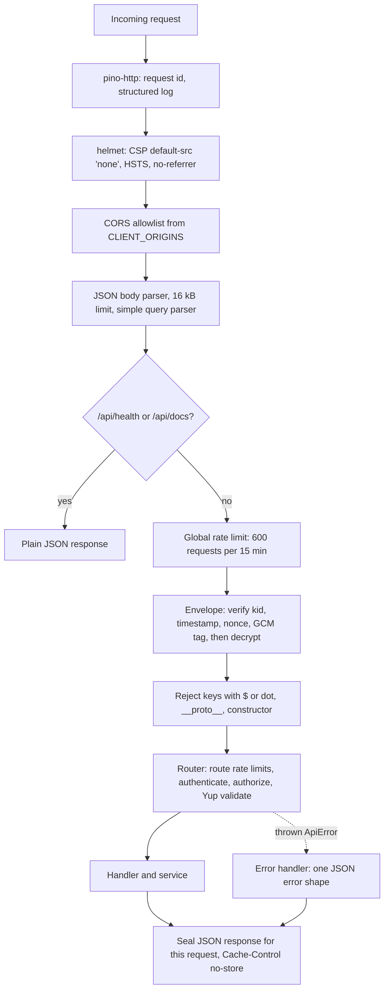
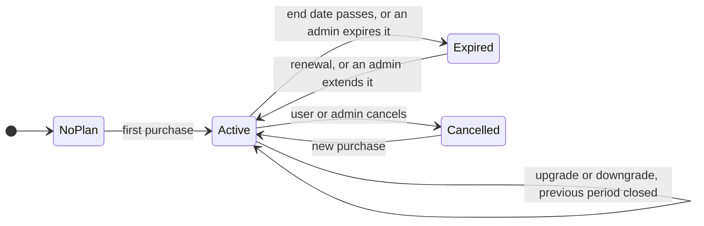
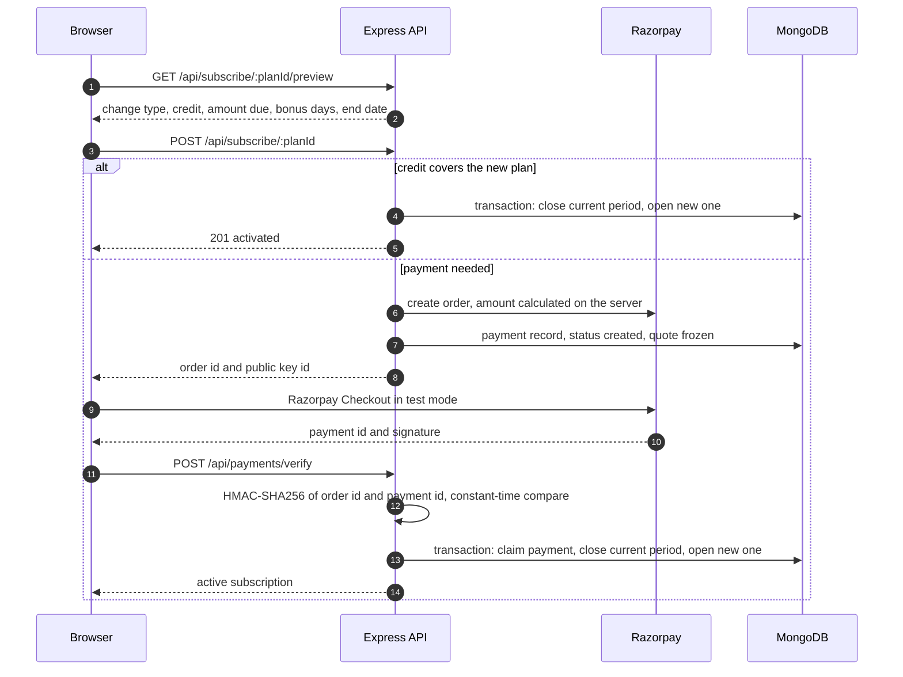

# PlanPilot architecture

This document goes one level deeper than the [README](../README.md): how a request travels through the API, how the encrypted envelope and the session tokens work, the data model, and the subscription lifecycle. Every section links to the code that implements it.

- [Request pipeline](#request-pipeline)
- [Encrypted API envelope](#encrypted-api-envelope)
- [Sessions and tokens](#sessions-and-tokens)
- [Account status and sign-in errors](#account-status-and-sign-in-errors)
- [Data model](#data-model)
- [Subscription lifecycle](#subscription-lifecycle)
- [Usage limits](#usage-limits)
- [Response and error format](#response-and-error-format)

## Request pipeline

The order is fixed in [`server/src/app.ts`](../server/src/app.ts) and matters: input checks run **after** decryption, so an encrypted body gets exactly the same scrutiny as a plain one.



| Stage                    | Code                                                                                                              |
| ------------------------ | ----------------------------------------------------------------------------------------------------------------- |
| Security headers, CORS   | [`middlewares/security.ts`](../server/src/middlewares/security.ts)                                                |
| Rate limits              | [`middlewares/rate-limit.ts`](../server/src/middlewares/rate-limit.ts)                                            |
| Envelope                 | [`middlewares/encryption.ts`](../server/src/middlewares/encryption.ts)                                            |
| Unsafe key rejection     | [`middlewares/sanitize.ts`](../server/src/middlewares/sanitize.ts)                                                |
| Authentication and roles | [`middlewares/authenticate.ts`](../server/src/middlewares/authenticate.ts)                                        |
| Validation               | [`middlewares/validate.ts`](../server/src/middlewares/validate.ts), [`shared/src/schemas`](../shared/src/schemas) |
| Errors                   | [`middlewares/error-handler.ts`](../server/src/middlewares/error-handler.ts)                                      |

## Encrypted API envelope

HTTPS stays the primary transport protection. The envelope is defence in depth: request and response bodies can't be read in DevTools or a proxy log, can't be modified, and can't be replayed. Only the server's **public** key ships in the browser bundle, so there is no shared secret to extract.

One implementation, [`shared/src/crypto/envelope.ts`](../shared/src/crypto/envelope.ts), runs in both the browser and Node 24, because both expose the Web Crypto API.

**Key agreement**

1. `npm run gen:keys` creates the server's static ECDH P-256 key pair. The private key (PKCS#8) stays in `server/.env`; the public key also goes to the client as `VITE_PAYLOAD_PUBLIC_KEY`. `PAYLOAD_KID` names the key so it can be rotated (`npm run gen:keys -- --rotate`).
2. On its first request each tab creates an ephemeral ECDH key pair whose private half is **non-extractable** ([`client/src/api/crypto-session.ts`](../client/src/api/crypto-session.ts)).
3. Both sides run ECDH, then HKDF-SHA-256 (salt = SHA-256 of both public keys, info `planpilot/envelope/v1`) to get the same AES-256-GCM key.
4. The server derives the key from the client public key in the `X-Enc-Session` header and caches it for 30 minutes, so it needs no session storage and survives restarts.

**On the wire**

| Part            | Value                                                                                       |
| --------------- | ------------------------------------------------------------------------------------------- |
| Request headers | `X-Enc-Session` (client public key), `X-Enc-Kid`, `X-Enc-Ts` (ms), `X-Enc-Nonce` (16 bytes) |
| Body            | `{ "v": 1, "iv": "<12 random bytes>", "ct": "<ciphertext and 16-byte tag>" }` (base64)      |
| Request AAD     | `req`, method, path, timestamp, nonce                                                       |
| Response        | Same envelope plus an `X-Enc: 1` header and `Cache-Control: no-store`                       |
| Response AAD    | `res`, the request's nonce, the HTTP status                                                 |

The AAD binds a body to its exact request, and a response to the request that asked for it, so ciphertext can't be moved onto another call. Error bodies are sealed too; only the HTTP status stays readable.

**Checks and their errors**

| Check                                                      | Error                                       |
| ---------------------------------------------------------- | ------------------------------------------- |
| No envelope while `ENCRYPTION_REQUIRED` (production)       | `400 ENCRYPTION_REQUIRED`                   |
| Key id differs from the server's                           | `400 UNKNOWN_KEY`                           |
| Timestamp more than 2 minutes from server time             | `400 STALE_REQUEST`                         |
| Nonce already seen (POST, PUT, PATCH, DELETE)              | `409 REPLAYED_REQUEST`                      |
| Malformed headers, wrong key, bad tag, wrong AAD, not JSON | `400 INVALID_PAYLOAD` (one generic message) |

The Axios interceptors in [`client/src/api/http.ts`](../client/src/api/http.ts) seal requests and open responses. They also learn the server clock from the `Date` header, and on `STALE_REQUEST` they correct the offset and retry once, so a device with a wrong clock still works.

## Sessions and tokens

| Token   | Format and lifetime                                                            | Where it lives                                                                                          |
| ------- | ------------------------------------------------------------------------------ | ------------------------------------------------------------------------------------------------------- |
| Access  | JWT HS256, 15 minutes, claims `sub`, `role`, `sid`; issuer and audience pinned | Redux memory only ([`authSlice.ts`](../client/src/features/auth/authSlice.ts))                          |
| Refresh | 32 random bytes, 7 days; only its SHA-256 hash is stored                       | Cookie `__Host-pp_rt`: HttpOnly, Secure, SameSite=Strict, Path=/ (`pp_rt` without Secure on local http) |

- **Rotation.** Every refresh atomically revokes the presented token and issues a new one in the same _family_ (one family = one signed-in device), in [`auth.service.ts`](../server/src/modules/auth/auth.service.ts).
- **Reuse detection.** A rotated token presented again more than 30 seconds later means someone kept an old copy: the whole family is revoked and a `security.refresh_token_reuse` entry is written to the activity log. Within 30 seconds it is treated as two tabs racing, and the client simply retries.
- **Revocation.** Logout, "sign out everywhere", a password change (other devices), an admin block or inactivation, a role change and an admin force sign-out all revoke sessions. `authenticate` checks that the session family is still alive and re-reads the user on every request, so these take effect on the very next call.
- **CSRF.** The cookie is only accepted on `/auth/refresh` and `/auth/logout`, which also require the `X-Requested-With: planpilot` header and, when the browser sends an `Origin`, an allowlisted one.
- **Client.** [`SessionManager.tsx`](../client/src/features/auth/SessionManager.tsx) restores the session on load, refreshes 60 seconds before expiry, signs out after 30 idle minutes (with a 60-second warning) and follows sign-in and sign-out in other tabs through a `BroadcastChannel`. [`baseQuery.ts`](../client/src/api/baseQuery.ts) retries a request once after a `401 TOKEN_EXPIRED`; parallel callers share one refresh (single flight), and the Web Locks API stops two tabs from refreshing at the same moment.

## Account status and sign-in errors

Admins can set an account to active, inactive or blocked, and give it an "access until" date. The status is checked **only after the password is verified** ([`account-guard.ts`](../server/src/modules/auth/account-guard.ts)), so someone typing a stranger's email learns nothing about the account.

| Situation                      | Response                     | Sign-in screen                                                        |
| ------------------------------ | ---------------------------- | --------------------------------------------------------------------- |
| Wrong email or password        | `401 INVALID_CREDENTIALS`    | "Email or password is incorrect." with attempts left near the limit   |
| Five failures in a row         | `429 ACCOUNT_LOCKED`         | Live countdown for the 15-minute lock                                 |
| Inactive                       | `403 ACCOUNT_INACTIVE`       | "Your account is inactive." with the admin's reason and support email |
| Blocked                        | `403 ACCOUNT_BLOCKED`        | "Your access has been blocked by an administrator." with the reason   |
| "Access until" date has passed | `403 ACCOUNT_ACCESS_EXPIRED` | "Your access expired on <date>."                                      |

Unknown emails run a dummy bcrypt comparison and are locked out the same way, so neither the response nor its timing reveals whether an account exists. An admin restriction on a signed-in user ends their session on the next request, with a modal that explains why.

## Data model

MongoDB through Mongoose 9. Money is stored as integer **paise** (₹799 is `79900`), so prices never touch floating point.

| Collection      | Key fields                                                                                                                                                                                           | Indexes                                                                                  |
| --------------- | ---------------------------------------------------------------------------------------------------------------------------------------------------------------------------------------------------- | ---------------------------------------------------------------------------------------- |
| `users`         | name, email, passwordHash (never selected by default), role, status, statusReason, accessExpiresAt, usage `{ projects, teamMembers }`, lastSeenAt, lockout fields                                    | unique email; role; status; lastSeenAt                                                   |
| `plans`         | name, slug, description, price, currency, durationDays, features[], limits `{ projects, teamMembers }` (`null` = unlimited), tier, isPopular, isActive                                               | unique slug; isActive                                                                    |
| `subscriptions` | userId, planId, startDate, endDate, status (`active`, `expired`, `cancelled`), amountPaid, creditBasis, changeType, previousSubscriptionId, paymentId, endReason, reminder timestamps, adjustments[] | **partial unique `{ userId }` where status is active**; `{ status, endDate }`; createdAt |
| `payments`      | userId, planId, subscriptionId, provider, razorpayOrderId, razorpayPaymentId, amount, status (`created`, `paid`, `failed`), changeType, frozen quote, failureReason                                  | **unique razorpayOrderId**; `{ status, paidAt }`                                         |
| `sessions`      | userId, familyId, tokenHash, userAgent, lastUsedAt, expiresAt, revokedAt, revokedReason, replacedByHash                                                                                              | unique tokenHash; familyId; TTL on expiresAt                                             |
| `projects`      | ownerId, name, description, color                                                                                                                                                                    | `{ ownerId, createdAt }`                                                                 |
| `teammembers`   | ownerId, name, email, role (`viewer`, `editor`)                                                                                                                                                      | unique `{ ownerId, email }`                                                              |
| `notifications` | userId, type, title, body, data, readAt                                                                                                                                                              | `{ userId, readAt, createdAt }`; TTL 60 days                                             |
| `activities`    | actorId, action, target `{ type, id, label }`, meta                                                                                                                                                  | `{ target.id, createdAt }`; TTL 30 days                                                  |

The partial unique index is the rule "one active plan per user" enforced by the database itself: two simultaneous purchases can't both succeed, because the second insert breaks the index and becomes a clean `409`.

## Subscription lifecycle



- **Change types.** A higher tier is an `upgrade`, a lower tier a `downgrade`. On the same tier a longer billing period (Pro to Pro Annual) counts as an upgrade. A first plan is `new`, a plan after an expired one is a `renewal`, and a plan set by an admin is `admin_assign`.
- **Expiry.** [`jobs/subscription-lifecycle.ts`](../server/src/jobs/subscription-lifecycle.ts) runs on boot and every 5 minutes. It expires plans past their end date and sends "expires soon" reminders 3 days and 1 day before the end, each exactly once (every update is conditional). Reads check expiry too, so a plan never looks active past its end date even if the free Render instance slept through a run.
- **Read-only workspace.** Without an active plan, projects and team members can be viewed and deleted, not created or edited (`403 READ_ONLY`).
- **Admin adjustments.** Extend by days or to a date (also revives an expired plan), expire now, cancel, or assign any plan without payment. Each needs a reason, is stored in the subscription's `adjustments[]`, written to the activity log and sent to the user as a notification.

### Proration

[`proration.ts`](../server/src/modules/subscriptions/proration.ts) applies one rule to every change:

- `credit` = unused share of the current period's value, by time left, rounded down to whole paise. The period's value (`creditBasis`) is cash paid plus credit applied; admin-assigned plans have none, so they can't be turned into credit.
- `amount due` = new price minus credit, never below zero. Less than ₹1 counts as zero (Razorpay's minimum order).
- Credit left over after covering the new price becomes **bonus days** on the new plan, at the new plan's daily rate, capped at 365.
- The new plan always starts now. `GET /api/subscribe/:planId/preview` returns this breakdown before anything is charged.

### Payment flow



Verification is idempotent: the order id is unique and the payment is claimed with a conditional update (`created` to `paid`) inside the transaction, so a second or parallel verify returns the plan the first one activated. A dismissed or failed checkout is recorded through `POST /api/payments/:orderId/fail` and the user is notified. Without Razorpay keys (local development and tests) a simulated gateway runs the same order, signature and verify steps with no external calls ([`gateway.ts`](../server/src/modules/payments/gateway.ts)).

## Usage limits

| Plan            | Projects  | Team members |
| --------------- | --------- | ------------ |
| No active plan  | read-only | read-only    |
| Starter         | 3         | 2            |
| Pro, Pro Annual | 25        | 10           |
| Business        | Unlimited | 50           |

The server enforces limits; the client only displays them. Creating a project or adding a member reserves a slot with one conditional update, "add 1 to `usage.projects` only if it is below the limit" ([`usage.service.ts`](../server/src/modules/workspace/usage.service.ts)). MongoDB applies it atomically, so two requests racing for the last slot can't both get it, which counting first and inserting afterwards would allow. If nothing matched, the API answers `403 PLAN_LIMIT_REACHED` and the client opens the upgrade dialog. Deleting releases the slot. After a downgrade below current usage nothing is deleted; new items are blocked until usage is back under the limit.

## Response and error format

Every response uses one envelope, defined in [`shared/src/types.ts`](../shared/src/types.ts) and [`shared/src/errors.ts`](../shared/src/errors.ts).

```json
{ "success": true, "data": {}, "meta": { "page": 1, "pageSize": 10, "total": 42, "totalPages": 5 } }
```

```json
{
  "success": false,
  "error": {
    "code": "VALIDATION_ERROR",
    "message": "Please fix the highlighted fields",
    "details": [{ "field": "password", "message": "Add an uppercase letter" }],
    "requestId": "3f2b0c1e-6a7d-4f4e-9b1a-2c8d5e7f9a10"
  }
}
```

The client switches on `code`, never on message text, and maps `details` back onto the matching form fields.

| Status | Codes                                                                                                                                                                                                                 |
| ------ | --------------------------------------------------------------------------------------------------------------------------------------------------------------------------------------------------------------------- |
| 400    | `BAD_REQUEST`, `INVALID_JSON`, `INVALID_PAYLOAD`, `STALE_REQUEST`, `UNKNOWN_KEY`, `ENCRYPTION_REQUIRED`, `WRONG_PASSWORD`, `NO_ACTIVE_SUBSCRIPTION`, `PLAN_INACTIVE`, `PAYMENT_FAILED`, `PAYMENT_VERIFICATION_FAILED` |
| 401    | `UNAUTHORIZED`, `INVALID_CREDENTIALS`, `TOKEN_EXPIRED`, `INVALID_TOKEN`, `SESSION_EXPIRED`                                                                                                                            |
| 403    | `FORBIDDEN`, `ACCOUNT_INACTIVE`, `ACCOUNT_BLOCKED`, `ACCOUNT_ACCESS_EXPIRED`, `PLAN_LIMIT_REACHED`, `READ_ONLY`, `SELF_ACTION_FORBIDDEN`                                                                              |
| 404    | `NOT_FOUND`, `PLAN_NOT_FOUND`                                                                                                                                                                                         |
| 409    | `CONFLICT`, `EMAIL_TAKEN`, `ALREADY_SUBSCRIBED`, `REPLAYED_REQUEST`, `LAST_ADMIN`                                                                                                                                     |
| 413    | `PAYLOAD_TOO_LARGE`                                                                                                                                                                                                   |
| 422    | `VALIDATION_ERROR` with one `details` entry per failing rule                                                                                                                                                          |
| 429    | `RATE_LIMITED`, `ACCOUNT_LOCKED`, with a `Retry-After` header                                                                                                                                                         |
| 500    | `INTERNAL_ERROR`, never with a stack trace                                                                                                                                                                            |
| 502    | `GATEWAY_ERROR` when Razorpay is unreachable or rejects the order                                                                                                                                                     |
